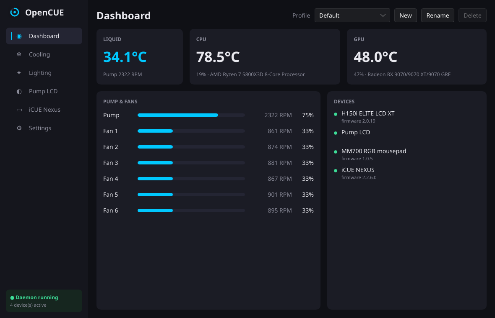
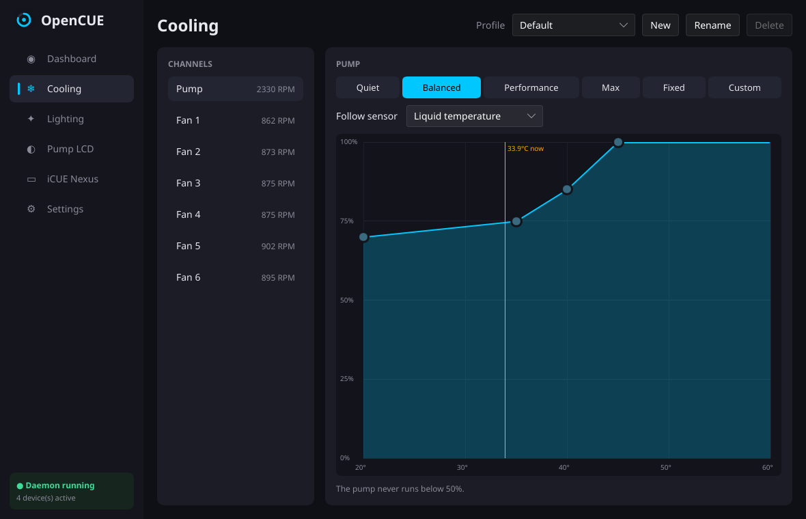
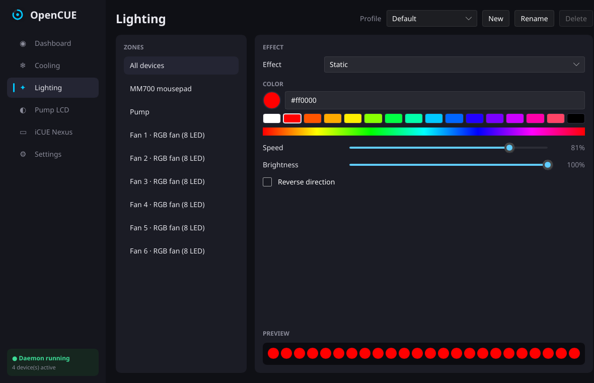
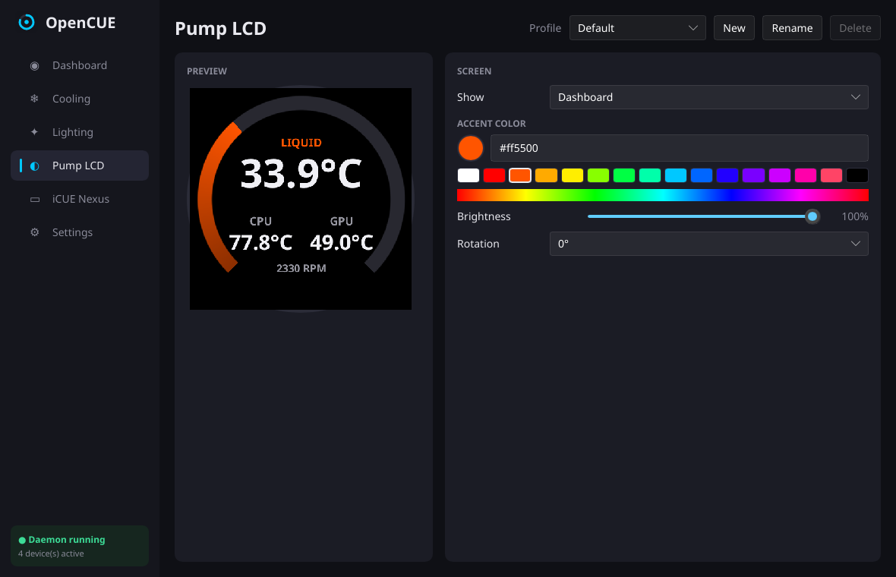
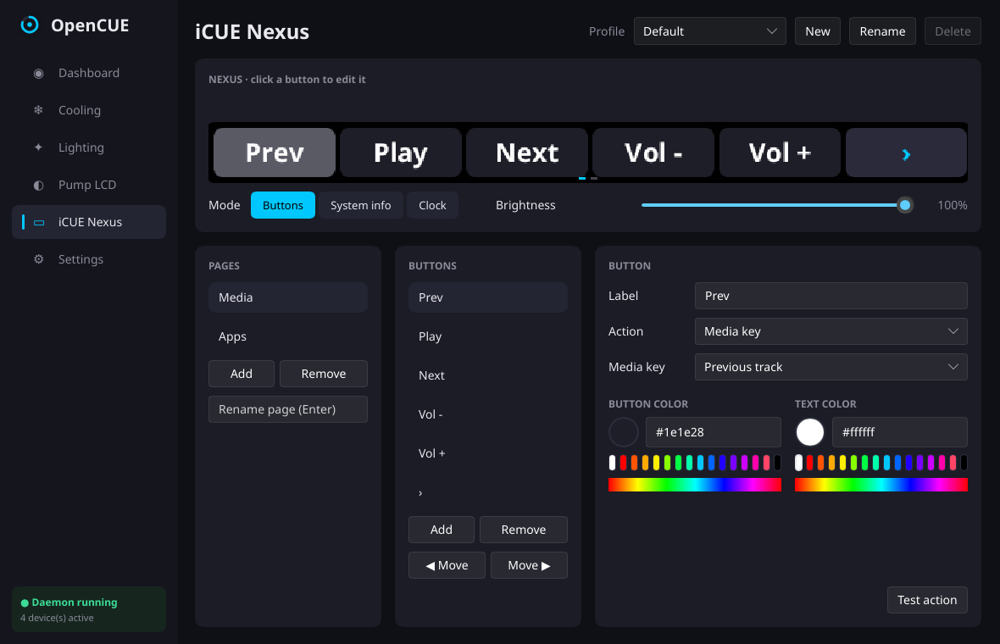

# OpenCUE

An open-source replacement for Corsair iCUE on Linux, written in Rust: fan and pump curves, RGB lighting,
the Elite LCD pump screen (including GIFs) and iCUE NEXUS touch shortcuts.



## Features

- **Cooling**: Quiet / Balanced / Performance / Max / Fixed / Custom curves per fan and pump, following
  liquid, CPU or GPU temperature, with a draggable curve editor. Fans ramp up fast and down slowly.
- **Lighting**: 13 effects (static, gradient, breathing, colour shift, rainbow, rainbow wave, colour wave,
  spinner, marquee, twinkle, temperature-reactive, Ambilight and off) synced across devices or set per zone.
  **Ambilight** follows your monitor's colours, with draggable device positions and adjustable sampling areas.
- **Pump LCD**: images and animated GIFs, or live liquid / CPU / GPU / pump-speed / dashboard / clock / text
  screens, with brightness and rotation.
- **iCUE NEXUS**: pages of touch buttons that press key combos or media keys, run commands, open URLs, type
  text, switch profiles or change the LCD screen. Also system-info, clock and **now playing** modes: the
  current track from Spotify or any other MPRIS player (browsers, VLC, mpv, ...) with cover art, a progress
  bar and touch controls. Music players are preferred over videos; tap the track info to switch players.
- **Game stats on the Nexus**: pick up to 6 of FPS, frame time, 1% and 0.1% lows, 99th percentile frame time,
  stutters, GPU temperature / hotspot / memory temperature, GPU load / power / clock, VRAM, CPU temperature and
  load, and liquid temperature. FPS comes from MangoHud (one click in the app sets it up).
- **Profiles** you can switch from the app, the CLI or a Nexus button.
- **Safety first**: every fan and the pump go to 100% above a critical liquid or CPU temperature, and any
  fan whose sensor stops reporting does the same. The pump never drops below 50%. When OpenCUE stops, the
  devices go back to their built-in hardware mode.
- **Light on resources**: a background service using around 1–2% CPU while animating everything, and a
  separate app you only open when you want to change something.

| Cooling | Lighting |
| --- | --- |
|  |  |
| **Pump LCD** | **iCUE NEXUS** |
|  |  |

## Supported hardware

| Device | USB id | Status |
| --- | --- | --- |
| iCUE Commander Core (H100i/H115i/H150i/H170i Elite Capellix, Elite LCD, Elite LCD XT) | `1b1c:0c32`, `1b1c:0c1c` | Tested on 0c32 (H150i Elite LCD XT) |
| Elite LCD pump screen | `1b1c:0c39`, `1b1c:0c33` | Tested on 0c39 |
| iCUE NEXUS | `1b1c:1b8e` | Tested |
| MM700 RGB mousepad | `1b1c:1b9b`, `1b1c:1bc9` | Tested on 1b9b |

Have another Corsair device? Open a [device support request](.github/ISSUE_TEMPLATE/device_request.md).

## Install

### Arch Linux (AUR)

```sh
yay -S opencue-bin                     # or paru, or any AUR helper
systemctl --user enable --now opencue  # as your user, not root
```

Then unplug and replug your Corsair devices (or reboot) so the device access rule applies.

### Any distro: prebuilt download

For x86_64 Linux with glibc 2.35 or newer (Debian 12, Ubuntu 22.04, Fedora 36 and later). No Rust needed.

```sh
curl -fsSL https://github.com/lfreixial/opencue/releases/latest/download/opencue-x86_64-linux.tar.gz | tar xz
cd opencue-linux
./install.sh               # install to ~/.local/bin, start the service at login
sudo ./install.sh --udev   # once: give your user access to the devices (no root at runtime)
```

### From source

You need a Rust toolchain (`pacman -S rust`, `rustup`, or `mise use -g rust`).

```sh
git clone https://github.com/lfreixial/opencue.git
cd opencue
./install.sh               # build, install to ~/.local/bin, start the service at login
sudo ./install.sh --udev   # once: give your user access to the devices (no root at runtime)
```

**Updates**: the app checks GitHub for a new release when it opens and once a day (Settings, Updates; turn it
off there). A download or source install updates itself with the **Update** button; an AUR install updates
with your AUR helper as usual. The check is a single request to GitHub's public API, and nothing about you or
your system is sent.

Then open **OpenCUE** from your app menu, or run `opencue-gui`. It also opens minimized at login
(`~/.config/autostart/opencue.desktop`); Settings has switches to turn that off or open the window normally.

### Uninstall

- AUR: `systemctl --user disable --now opencue`, then `sudo pacman -R opencue-bin`.
- Download or source: `./install.sh --uninstall` from the same folder, then
  `sudo rm /etc/udev/rules.d/70-opencue.rules`. Your settings stay in `~/.config/opencue`.

## Command line

```
opencue status            temperatures, fan speeds and devices
opencue devices           Corsair USB devices and whether OpenCUE can access them
opencue profile [NAME]    list profiles, or switch to NAME
opencue rescan            look for newly plugged-in devices now
opencue daemon            run the service in the foreground (RUST_LOG=debug for detail)
```

Settings live in `~/.config/opencue/config.json`. Images chosen for the LCD are copied into
`~/.config/opencue/media/`.

## Ambilight

In **Lighting**, select **All devices** (or enable custom lighting for one zone), choose **Ambilight**,
then click **Choose monitor…** and select a monitor in your desktop's screen-sharing dialog. Drag each
device marker on the monitor preview to the area it should follow: devices on the left sample the left,
devices on the right sample the right. The outlined boxes show the sampled areas; **Sample area** changes
their size. Each device shows the average colour of its area, with the zone's brightness applied.
Positions and sampling size are saved per profile. Grey markers belong to zones using another effect.

Capture requires PipeWire, a desktop portal backend that supports screen sharing (such as KDE, GNOME or
wlroots), and GStreamer tools, base plugins and the PipeWire plugin:

```sh
# Arch Linux
sudo pacman -S gstreamer gst-plugins-base pipewire-gstreamer
# Debian / Ubuntu
sudo apt install gstreamer1.0-tools gstreamer1.0-plugins-base gstreamer1.0-pipewire
```

Sharing targets 60 frames per second, using a small colour grid and dropping stale frames to keep
latency low. The layout preview updates at 15 fps while visible; hiding it stops preview transfers.
Sharing continues in the daemon when the app window closes. For performance testing, use optimized
builds: `cargo run --release -p opencue -- daemon` and, in another terminal,
`cargo run --release -p opencue-gui -- --page lighting`.
Use **Stop sharing** or your desktop's sharing indicator to stop it. Capture also stops when the active
profile no longer uses Ambilight. Choose the monitor again after restarting the daemon or ending sharing.
Pixels stay in memory; no screen recordings are saved. Ambilight zones turn off when sharing ends.

## Troubleshooting

- **The window opens (not minimized) at login on KDE Plasma**: Plasma restores apps that were open when
  you logged out. Exclude it in System Settings, Session, Desktop Session, "Applications to be excluded
  from session" (`opencue-gui`), and the login entry opens it minimized instead.
- **"no permission for /dev/hidrawN"**: run `sudo ./install.sh --udev`, then unplug and replug the
  device (or reboot).
- **Nexus shortcuts do nothing**: the udev rule also grants access to `/dev/uinput`, which is used to
  send key presses. Check the daemon log with `journalctl --user -u opencue`.
- **Ambilight cannot share a monitor**: check the status under **Choose monitor…**. Install the capture
  packages above and your desktop's screen-sharing portal backend; a file-picker-only portal backend
  cannot capture a monitor. If sharing is cancelled or revoked, choose the monitor again.
- **Now playing shows nothing**: the player has to support MPRIS. Spotify, browsers, VLC and most music
  players do; mpv needs the `mpv-mpris` plugin (`sudo pacman -S mpv-mpris`). Cover art from the web is
  downloaded with `curl`, and local videos without art get a thumbnail made with `ffmpeg`.
- **Game stats show `--` for FPS**: MangoHud has to be set up from the Nexus page (Game stats, Set up MangoHud),
  then log out and back in. That sets `MANGOHUD=1` in `~/.config/environment.d/opencue-mangohud.conf`, so every
  Vulkan game (including everything running through Proton) loads MangoHud, and adds `alpha=0`,
  `background_alpha=0`, `autostart_log=1`, `log_interval=0`, `log_duration=0` and `output_folder` to
  `~/.config/MangoHud/MangoHud.conf`. The overlay is fully transparent (MangoHud's `no_display` would hide it
  too, but then it stops logging) while it logs every frame to
  `~/.cache/opencue/mangohud/` (about 15 KB per second of play; OpenCUE deletes each log a couple of minutes after
  the game closes). OpenGL-only games still need the launch option `mangohud %command%`. A per-game MangoHud
  config replaces the global one, so add the same lines there too.
- **Showing MangoHud's overlay in a game**: MangoHud's own toggle key would stop the logging, so OpenCUE
  unbinds it. Use the switch in Game stats, or `opencue overlay toggle` (`show`, `hide`); running games pick
  it up within a second. For a key combo, add a command shortcut in System Settings (Keyboard, Shortcuts, Add
  New, Command) that runs `~/.local/bin/opencue overlay toggle`, written out as the full path.
- **iCUE in a Windows VM, or another tool such as liquidctl or OpenLinkHub, is also controlling the
  devices**: only one program should talk to them at a time.

## How it works

- `crates/opencue-core`: device drivers over raw `hidraw`, config, fan curves, effects, LCD and Nexus
  renderers, and the IPC types
- `crates/opencue`: the daemon (one thread per device, with automatic reconnect) and the CLI
- `crates/opencue-gui`: the [Slint](https://slint.dev) app; it talks to the daemon over a Unix socket and
  previews use the same renderers as the hardware

The protocol knowledge comes from the reverse-engineering work in
[liquidctl](https://github.com/liquidctl/liquidctl) and
[OpenLinkHub](https://github.com/jurkovic-nikola/OpenLinkHub). Thank you to both projects.

See [CONTRIBUTING.md](CONTRIBUTING.md) to build from source or add a device.

## License

GPL-3.0-or-later. See [LICENSE](LICENSE).

OpenCUE is an independent project and is not affiliated with, endorsed by, or sponsored by Corsair.
Corsair, iCUE, Elite Capellix and iCUE NEXUS are trademarks of CORSAIR MEMORY, Inc.
