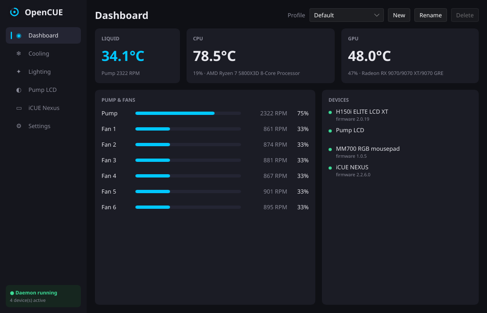
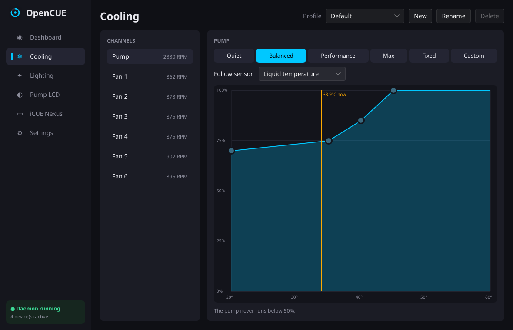
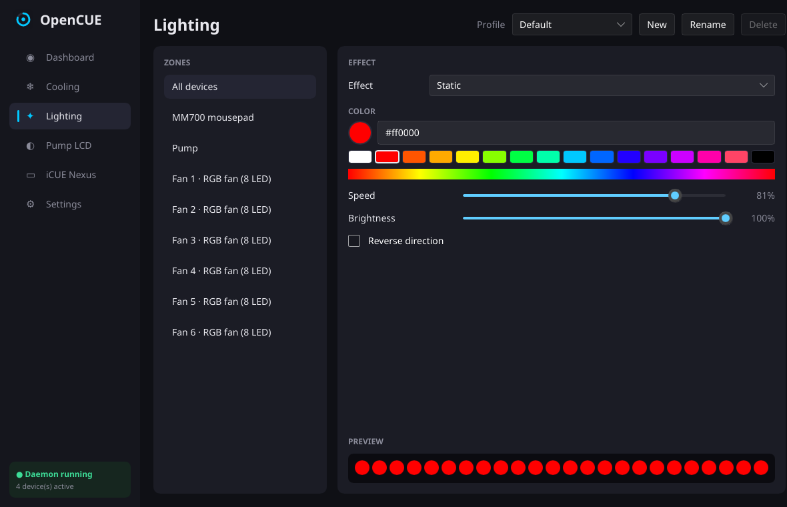
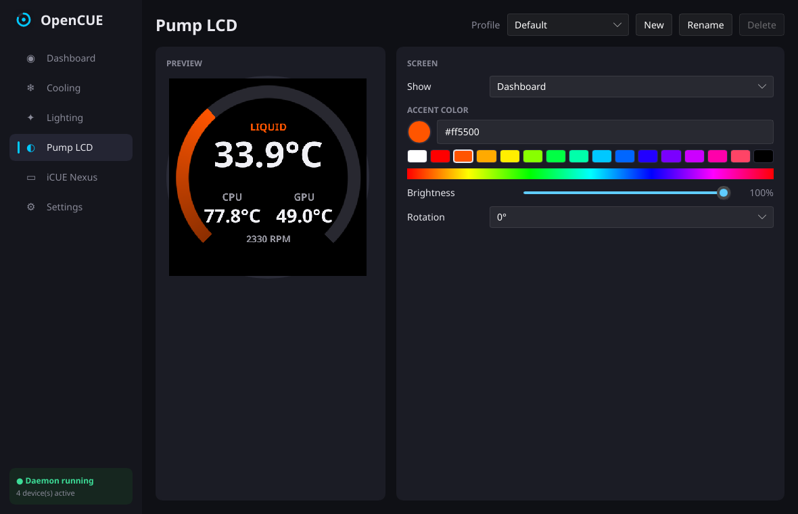
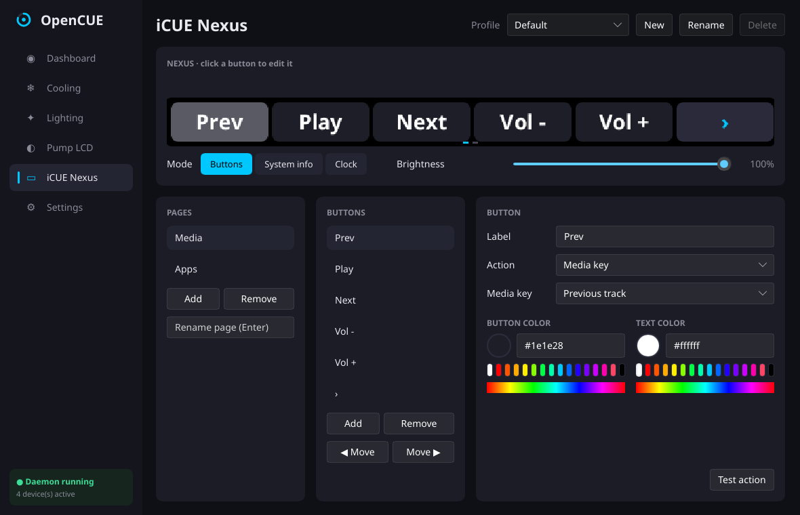

# OpenCUE

An open-source replacement for Corsair iCUE on Linux, written in Rust: fan and pump curves, RGB lighting,
the Elite LCD pump screen (including GIFs) and iCUE NEXUS touch shortcuts.



## Features

- **Cooling**: Quiet / Balanced / Performance / Max / Fixed / Custom curves per fan and pump, following
  liquid, CPU or GPU temperature, with a draggable curve editor. Fans ramp up fast and down slowly.
- **Lighting**: 12 effects (static, gradient, breathing, colour shift, rainbow, rainbow wave, colour wave,
  spinner, marquee, twinkle, temperature-reactive and off) synced across devices or set per zone.
- **Pump LCD**: images and animated GIFs, or live liquid / CPU / GPU / pump-speed / dashboard / clock / text
  screens, with brightness and rotation.
- **iCUE NEXUS**: pages of touch buttons that press key combos or media keys, run commands, open URLs, type
  text, switch profiles or change the LCD screen. Also system-info, clock and **now playing** modes: the
  current track from Spotify or any other MPRIS player (browsers, VLC, mpv, ...) with cover art, a progress
  bar and touch controls. Music players are preferred over videos; tap the track info to switch players.
- **Profiles** you can switch from the app, the CLI or a Nexus button.
- **Safety first**: every fan and the pump go to 100% above a critical liquid or CPU temperature, and any
  fan whose sensor stops reporting does the same. The pump never drops below 50%. When OpenCUE stops, the
  devices go back to their built-in hardware mode.
- **Light on resources**: a background service using around 1–2% CPU while animating everything, and a
  separate app you only open when you want to change something.

| Cooling | Lighting |
| --- | --- |
|  |  |
| **Pump LCD** | **iCUE NEXUS** |
|  |  |

## Supported hardware

| Device | USB id | Status |
| --- | --- | --- |
| iCUE Commander Core (H100i/H115i/H150i/H170i Elite Capellix, Elite LCD, Elite LCD XT) | `1b1c:0c32`, `1b1c:0c1c` | Tested on 0c32 (H150i Elite LCD XT) |
| Elite LCD pump screen | `1b1c:0c39`, `1b1c:0c33` | Tested on 0c39 |
| iCUE NEXUS | `1b1c:1b8e` | Tested |
| MM700 RGB mousepad | `1b1c:1b9b`, `1b1c:1bc9` | Tested on 1b9b |

Have another Corsair device? Open a [device support request](.github/ISSUE_TEMPLATE/device_request.md).

## Install

You need a Rust toolchain (`pacman -S rust`, `rustup`, or `mise use -g rust`).

```sh
git clone https://github.com/lfreixial/opencue.git
cd opencue
./install.sh               # build, install to ~/.local/bin, start the service at login
sudo ./install.sh --udev   # once: give your user access to the devices (no root at runtime)
```

Then open **OpenCUE** from your app menu, or run `opencue-gui`.

Uninstall:

```sh
systemctl --user disable --now opencue
rm ~/.local/bin/opencue ~/.local/bin/opencue-gui ~/.config/systemd/user/opencue.service \
   ~/.local/share/applications/opencue.desktop ~/.local/share/icons/hicolor/scalable/apps/opencue.svg
sudo rm /etc/udev/rules.d/70-opencue.rules
```

## Command line

```
opencue status            temperatures, fan speeds and devices
opencue devices           Corsair USB devices and whether OpenCUE can access them
opencue profile [NAME]    list profiles, or switch to NAME
opencue rescan            look for newly plugged-in devices now
opencue daemon            run the service in the foreground (RUST_LOG=debug for detail)
```

Settings live in `~/.config/opencue/config.json`. Images chosen for the LCD are copied into
`~/.config/opencue/media/`.

## Troubleshooting

- **"no permission for /dev/hidrawN"**: run `sudo ./install.sh --udev`, then unplug and replug the
  device (or reboot).
- **Nexus shortcuts do nothing**: the udev rule also grants access to `/dev/uinput`, which is used to
  send key presses. Check the daemon log with `journalctl --user -u opencue`.
- **Now playing shows nothing**: the player has to support MPRIS. Spotify, browsers, VLC and most music
  players do; mpv needs the `mpv-mpris` plugin. Cover art from the web is downloaded with `curl`.
- **iCUE in a Windows VM, or another tool such as liquidctl or OpenLinkHub, is also controlling the
  devices**: only one program should talk to them at a time.

## How it works

- `crates/opencue-core`: device drivers over raw `hidraw`, config, fan curves, effects, LCD and Nexus
  renderers, and the IPC types
- `crates/opencue`: the daemon (one thread per device, with automatic reconnect) and the CLI
- `crates/opencue-gui`: the [Slint](https://slint.dev) app; it talks to the daemon over a Unix socket and
  previews use the same renderers as the hardware

The protocol knowledge comes from the reverse-engineering work in
[liquidctl](https://github.com/liquidctl/liquidctl) and
[OpenLinkHub](https://github.com/jurkovic-nikola/OpenLinkHub). Thank you to both projects.

See [CONTRIBUTING.md](CONTRIBUTING.md) to build from source or add a device.

## License

GPL-3.0-or-later. See [LICENSE](LICENSE).

OpenCUE is an independent project and is not affiliated with, endorsed by, or sponsored by Corsair.
Corsair, iCUE, Elite Capellix and iCUE NEXUS are trademarks of CORSAIR MEMORY, Inc.
